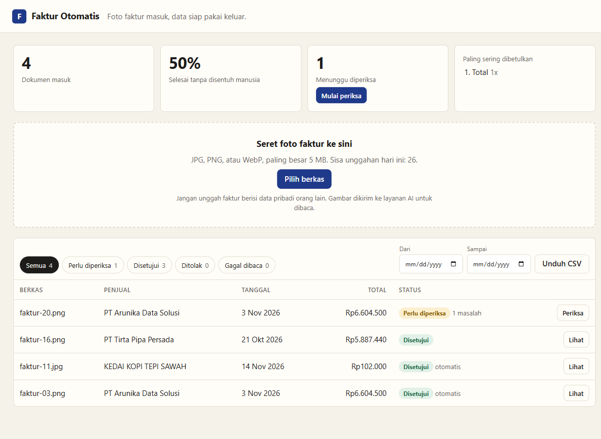
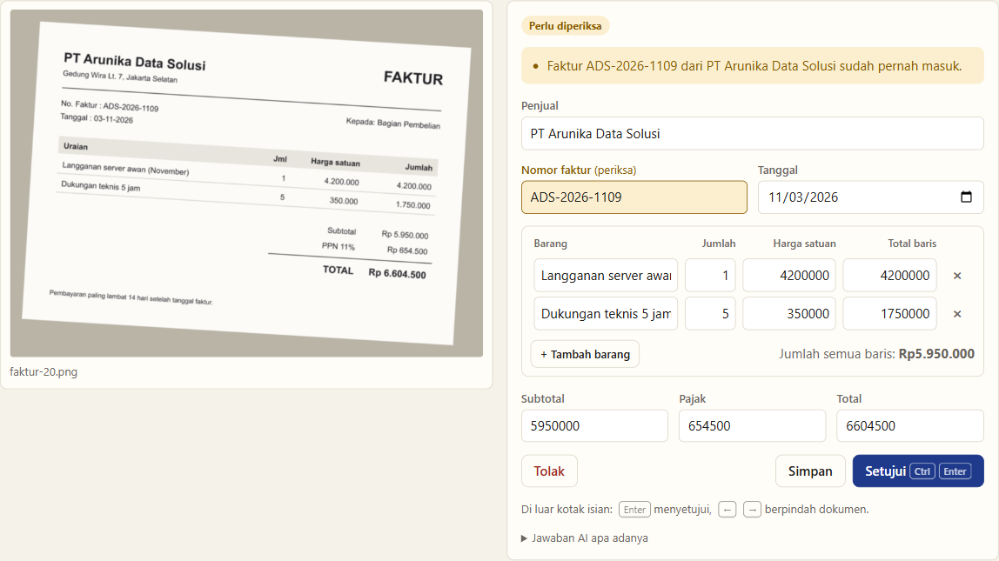

# Faktur Otomatis
n[](https://github.com/VivoHizkia/fakturin/actions/workflows/ci.yml)

Mengubah foto faktur, nota, dan struk menjadi data siap pakai, dan hanya meminta manusia memeriksa yang benar-benar meragukan.

Unggah gambar, AI menyalin isinya menjadi data terstruktur, lalu enam aturan di kode memutuskan: yang hitungannya cocok dan lengkap langsung disetujui, sisanya masuk antrean periksa dengan alasan yang jelas. Hasil akhirnya diekspor ke CSV atau dikirim ke webhook.





- **Hasil eval:** [hasil-eval/hasil.md](hasil-eval/hasil.md)
- **Keterbatasan dan langkah berikutnya:** [WRITEUP.md](WRITEUP.md)

## Cara kerja

```
Unggah gambar -> antre -> AI mengekstrak -> skema Zod -> aturan di kode
                                                |             |
                                  dua kali gagal skema        |
                                                |             |
                                                v             v
                                         Antrean periksa <- ada aturan dilanggar
                                                |
                              manusia membetulkan, setiap perubahan dicatat
                                                |
                    Disetujui (otomatis atau oleh manusia) -> CSV / webhook
```

1. **Unggah** (`/api/unggah`). Berkas diperiksa dari byte pertamanya, bukan dari nama atau header, lalu disimpan berstatus `antre`.
2. **Ekstraksi** (`src/lib/ekstrak/`). Gambar dikirim ke model dengan prompt yang meminta satu objek JSON. Jawaban divalidasi dengan skema Zod. Kalau tidak lolos, model diberi tahu galatnya dan dicoba sekali lagi.
3. **Aturan** (`src/lib/periksa/aturan.ts`). Lihat tabel di bawah.
4. **Periksa** (`/dokumen/[id]`). Gambar di kiri, formulir di kanan, kolom yang disebut aturan ditandai. Setiap kolom yang diubah dicatat sebagai koreksi.
5. **Keluaran**. CSV dengan saringan tanggal, dan webhook bertanda tangan HMAC untuk setiap dokumen yang disetujui.

## Aturan pemeriksaan

Prompt saja bukan jaminan, jadi hitungan dan kelengkapan dicek di kode. Dokumen masuk antrean periksa kalau salah satu ini terjadi:

| Aturan                   | Kapan terpicu                                                                                                                   |
| ------------------------ | ------------------------------------------------------------------------------------------------------------------------------- |
| Kolom wajib kosong       | Penjual, tanggal, atau total tidak terbaca                                                                                      |
| Jumlah baris tidak cocok | Jumlah semua baris barang berbeda lebih dari Rp1 dari subtotal (atau dari total dikurangi pajak, kalau subtotal tidak tertulis) |
| Total tidak cocok        | Subtotal ditambah pajak tidak sama dengan total                                                                                 |
| Tanggal tidak wajar      | Di masa depan, lebih dari 2 tahun lalu, atau tidak ada di kalender                                                              |
| Duplikat                 | Penjual dan nomor faktur sama dengan dokumen yang sudah masuk                                                                   |
| Gagal skema              | AI dua kali menjawab di luar bentuk yang diminta                                                                                |

## Hasil eval

`npm run eval` menjalankan 20 faktur contoh di `contoh/` dan membandingkan hasilnya dengan `contoh/jawaban.json`. Lima di antaranya sengaja dibuat bermasalah (total salah jumlah, baris salah, tanggal hilang, tanggal lama, duplikat).

Dengan `gemini-3.5-flash-lite`, dijalankan 16 November 2026:

| Ukuran                                                   | Hasil        |
| -------------------------------------------------------- | ------------ |
| Penjual, nomor faktur, tanggal, pajak, total             | 100% (20/20) |
| Subtotal                                                 | 95% (19/20)  |
| Baris barang (semua baris cocok)                         | 100% (20/20) |
| Dokumen bersih yang lolos otomatis                       | 100% (15/15) |
| Dokumen bermasalah yang tertangkap aturan                | 100% (5/5)   |
| Dokumen lolos otomatis padahal ada kolom yang salah baca | 1            |

Satu kesalahan itu ada di nota tulis tangan tanpa subtotal: model mengisi subtotal dengan jumlah barisnya sendiri alih-alih `null`. Hitungannya tetap cocok, jadi tidak ada aturan yang menangkapnya.

Angka ini jangan dibaca berlebihan. Gambar contoh dibuat oleh skrip (`npm run contoh`): hurufnya tercetak rapi dan gangguannya hanya miring, buram, pudar, resolusi rendah, dan kompresi JPEG. Foto faktur sungguhan dari ponsel, dengan lipatan, bayangan, dan tulisan tangan asli, akan lebih sulit. Lihat [WRITEUP.md](WRITEUP.md).

## Teknologi dan alasannya

| Pilihan                            | Alasan                                                                                                                                                                                                        |
| ---------------------------------- | ------------------------------------------------------------------------------------------------------------------------------------------------------------------------------------------------------------- |
| **Next.js 16 + TypeScript**        | Antarmuka dan rute API dalam satu proyek.                                                                                                                                                                     |
| **Zod**                            | Satu skema dipakai untuk memvalidasi jawaban AI dan isian manusia di halaman periksa.                                                                                                                         |
| **Gemini `gemini-3.5-flash-lite`** | Bisa membaca gambar dan gratis. Kliennya (`src/lib/llm.ts`) memakai API yang kompatibel dengan OpenAI, jadi ganti penyedia cukup dengan dua variabel lingkungan.                                              |
| **Penyimpanan berkas lokal**       | `db.json` dan folder gambar di `.data/`. Tanpa akun dan tanpa layanan apa pun untuk mencoba. Seluruh aplikasi hanya mengenal antarmuka `Gudang`, jadi menggantinya dengan Postgres tidak menyentuh kode lain. |
| **Vitest**                         | 81 tes untuk skema, ekstraksi, aturan, penyimpanan, alur dokumen, CSV, dan webhook. AI di-mock, jadi tes tidak butuh jaringan atau kunci.                                                                     |
| **CSS biasa**                      | Dua halaman tidak butuh kerangka CSS.                                                                                                                                                                         |

## Menjalankan

Butuh Node 20 ke atas.

```bash
npm install
cp .env.example .env.local   # isi LLM_API_KEY
npm run dev                  # http://localhost:3000
```

Kunci gratis bisa dibuat di [Google AI Studio](https://aistudio.google.com/apikey). Untuk mencoba tanpa faktur sendiri, unggah gambar dari folder `contoh/`.

| Perintah            | Guna                                                   |
| ------------------- | ------------------------------------------------------ |
| `npm test`          | Semua tes, tanpa jaringan                              |
| `npm run typecheck` | Pemeriksaan tipe                                       |
| `npm run eval`      | Mengukur akurasi terhadap 20 contoh (memakai kuota AI) |
| `npm run contoh`    | Membuat ulang gambar contoh dan `jawaban.json`         |
| `npm run format`    | Merapikan kode dengan Prettier                         |

## Struktur

| Berkas                         | Tugas                                                             |
| ------------------------------ | ----------------------------------------------------------------- |
| `src/lib/ekstrak/`             | Skema Zod, prompt, dan pemanggilan AI dengan satu kali coba ulang |
| `src/lib/periksa/aturan.ts`    | Enam aturan pemeriksaan, masing-masing satu fungsi                |
| `src/lib/periksa/keputusan.ts` | Simpan, setujui, tolak, dan pencatatan koreksi                    |
| `src/lib/proses.ts`            | Memproses satu dokumen dari antrean                               |
| `src/lib/gudang/`              | Antarmuka penyimpanan dan implementasi berkas lokal               |
| `src/lib/ekspor/`              | CSV dan webhook                                                   |
| `src/lib/batas.ts`             | Batas ukuran, jenis berkas, dan kuota harian                      |
| `src/app/api/`                 | Rute unggah, proses, dokumen, dan ekspor                          |
| `src/components/`              | Halaman depan dan halaman periksa                                 |
| `scripts/`                     | Pembuat gambar contoh dan eval                                    |
| `supabase/migrations/`         | Skema Postgres untuk tahap berikutnya (belum dipakai)             |

## Webhook

Isi `WEBHOOK_URL` untuk menerima setiap dokumen yang disetujui:

```json
{
  "peristiwa": "dokumen.disetujui",
  "dokumen": {
    "id": "...",
    "nama_berkas": "...",
    "lolos_otomatis": true,
    "diputuskan_pada": "..."
  },
  "faktur": { "penjual": "...", "total": 111000, "baris": [] }
}
```

Kalau `WEBHOOK_SECRET` diisi, permintaan membawa header `X-Faktur-Tanda-Tangan: sha256=<hmac>`, yaitu HMAC SHA-256 atas badan permintaan. Pengiriman dicoba sampai tiga kali; penolakan 4xx tidak diulang.

## Keamanan

- Jenis berkas ditentukan dari isinya. Nama berkas tidak pernah dipakai sebagai path.
- Teks dari faktur diperlakukan sebagai data: prompt melarang model menuruti instruksi di dalam gambar, dan sel CSV yang diawali `=`, `+`, `-`, atau `@` dimatikan supaya tidak dijalankan Excel sebagai rumus.
- Permintaan yang mengubah data ditolak kalau datang dari situs lain.
- **Belum ada login.** Siapa pun yang bisa membuka aplikasi bisa melihat dan mengubah semua dokumen. Jalankan di komputer sendiri atau di belakang jaringan tertutup sampai login ditambahkan.

## Lisensi

[MIT](LICENSE)
